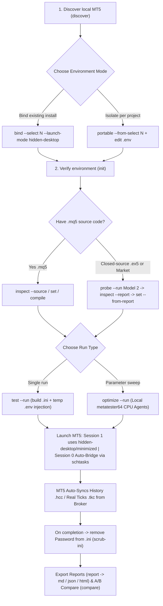
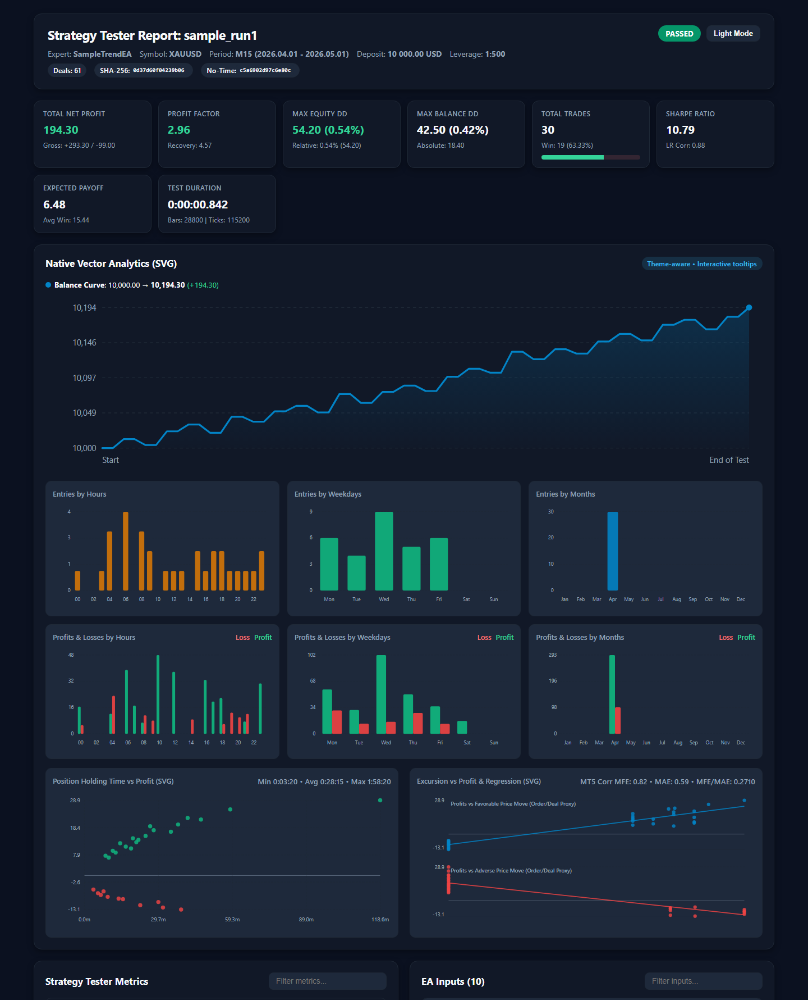
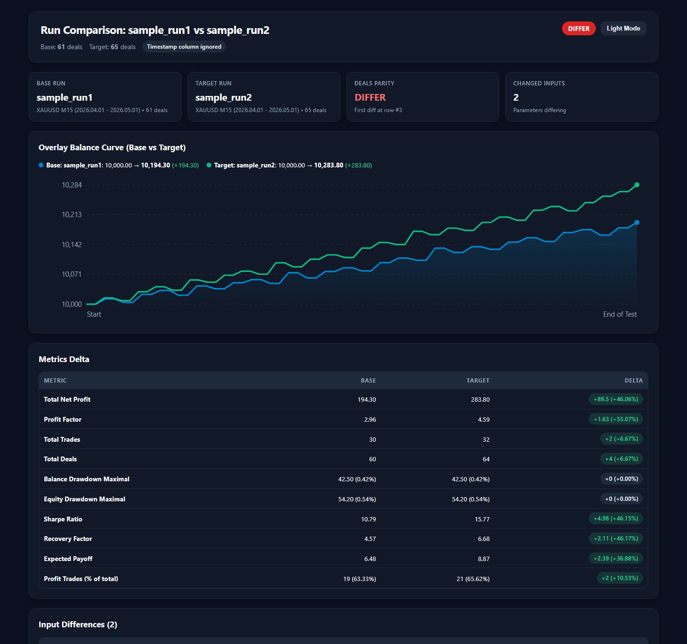
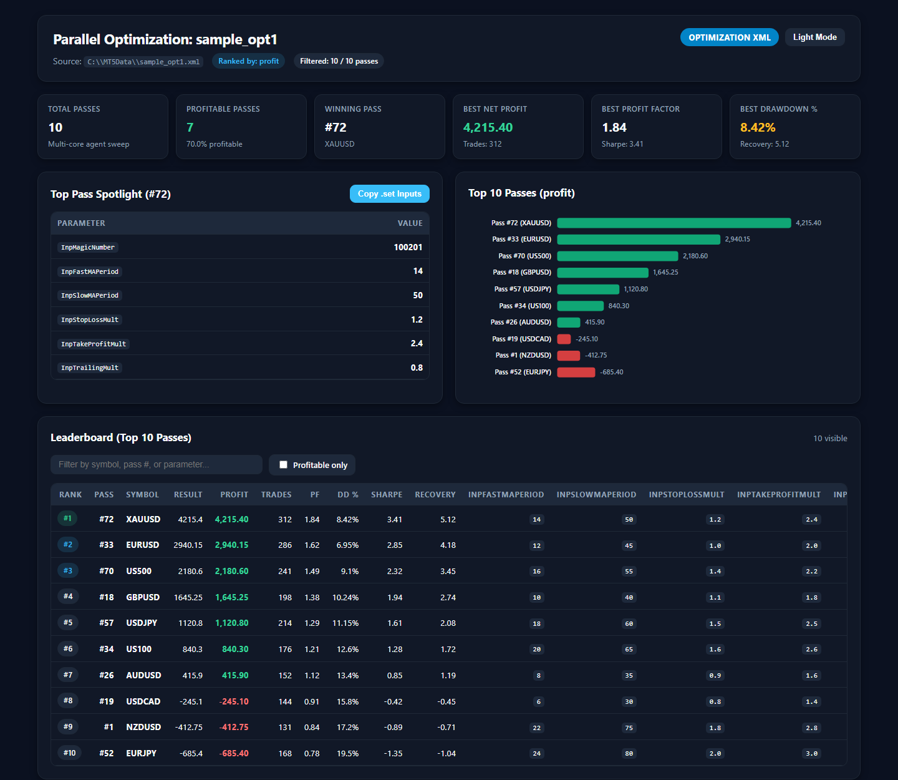

# MT5 Headless Tester

> 🌐 **Language**: **English (Default)** | [ภาษาไทย (Thai)](./README.th.md)

A cross-shell toolkit and AI Skill for automating MetaTrader 5 (MT5) **headlessly without stealing window focus** — covering local MT5 discovery, isolated `/portable` provisioning with Git credential protection, EA input & enum inspection (`.mq5` source and closed-source `.ex5` / Market EAs), UTF-16LE `.set` generation, compilation, non-intrusive single backtests, parallel multi-core optimizations, deal-by-deal comparison, and `.md` / `.json` / `.html` reporting.

Consistent CLI behavior across **Windows CMD**, **Bash / Git Bash**, **PowerShell**, and **Python directly**.

---

## Key Capabilities

| Category | Core Commands | Description |
|---|---|---|
| **Multi-AI Installer** | `install` | Automatically installs this skill + `/mt5-headless` slash commands, workflows, prompts, rules, and `AGENTS.md` sections across Antigravity, Claude Code, Codex, Cursor, Windsurf, Cline, Roo Code, Copilot, and generic `.agents/` |
| **Discover & Bind** | `discover`, `bind`, `init` | Scans all local MT5 installs + `%APPDATA%` Data Folders (skipping orphaned GUID folders without binaries) and binds them to a project via `.mt5-headless.json` |
| **Isolated Portable Mode** | `portable` | Provisions an isolated `.mt5-portable\` folder per project, copies binaries/include/servers, and generates a `.env` template protected in both `.gitignore` and `.git/info/exclude` |
| **EA Input & Enum Discovery** | `inspect`, `probe` | Parses `input`, `input group`, and `enum` declarations (resolving symbolic names to 0-based ordinals) from `.mq5`/`.mqh`, or runs a 1–2 day `probe` to extract inputs from `.ex5`/Market EAs |
| **`.set` Builder & Diff** | `set`, `set --diff` | Builds `.set` files (UTF-16LE with BOM + CRLF) from profiles, existing `.set` files, `probe` reports, or `.mq5` sources while preserving `||start||step||stop||Y/N` tails and rejecting typos |
| **Compile Gate** | `compile` | Compiles `.mq5` via `MetaEditor64.exe` with space-safe staging, `#property icon` resolution, `.log` verification (`0 errors`), and `.ex5` freshness checks |
| **Focus-Safe Backtesting** | `test` | Supports 4 launch modes (`hidden-desktop`, `minimized`, `hidden`, `ghost`), temporarily injects `.env` credentials then deletes them (`scrub-ini`), and auto-bridges from Session 0 on VMs/VPS |
| **Parallel Multi-Core Sweep** | `optimize` | Executes `Optimization=1` (Complete) or `2` (Genetic) sweeps across local `metatester64.exe` CPU agents, parses `.xml` passes, ranks metrics, and exports top `.set` presets |
| **Reports & A/B Compare** | `report`, `compare` | Exports Text, Markdown (`.md`), JSON (`.json`), or interactive HTML Dashboards (`.html`) with 9 Native SVG charts, plus deal-by-deal regression diffs (ignoring forced `end of test` close times) |

---

## Project Structure

```text
mt5-headless-tester/
├── SKILL.md                             # Agent instructions, workflows, and guardrails
├── README.md                            # Primary documentation (English — this file)
├── README.th.md                         # Supplementary documentation (Thai / ภาษาไทย)
├── scripts/
│   ├── mt5_headless.py                  # Core CLI (Python 3.9+ Standard Library only)
│   ├── mt5-headless.cmd                 # Windows CMD wrapper (loads .env + locates Python)
│   ├── mt5-headless.sh                  # Bash / Git Bash wrapper
│   └── Invoke-MT5Headless.ps1           # PowerShell wrapper (+ auto-bootstraps Python)
├── references/
│   ├── ini-and-set-format.md            # .ini, .set, [Common] keys, and .env variables reference
│   └── troubleshooting.md               # Troubleshooting guide (Focus, Compile, Market EA, Session 0 VM)
└── examples/
    ├── sample_single_report.html        # Sample single backtest HTML dashboard (9 Native SVG charts)
    ├── preview_single_report.png        # Preview screenshot of single backtest HTML dashboard
    ├── sample_compare_report.html       # Sample Base vs Target HTML comparison report
    ├── preview_compare_report.png       # Preview screenshot of comparison HTML report
    ├── sample_optimization_report.html  # Sample Parallel Optimization leaderboard HTML report
    └── preview_optimization_report.png  # Preview screenshot of Optimization Leaderboard
```

---

## Installation & Environment Setup

### 1. System Requirements
- **OS**: Windows 10 / 11 or Windows Server (with 64-bit MetaTrader 5 installed)
- **Python**: Python `3.9+` — [mt5_headless.py](./scripts/mt5_headless.py) uses the **Python Standard Library only** (`pip install` is not required).
- **Zero-Python / Windows 11 Store Stub Handling (`WindowsApps\python.exe`)**:
  - [Invoke-MT5Headless.ps1](./scripts/Invoke-MT5Headless.ps1) and [mt5-headless.cmd](./scripts/mt5-headless.cmd) automatically ignore Microsoft Store alias stubs (`*WindowsApps*`). If no real Python installation is found, they automatically download and unpack **Python 3.12.8 Embeddable** into `.python\` (or you can pre-install it using the commands below):

```cmd
:: Pre-install embeddable Python inside the skill folder (CMD / PowerShell)
scripts\mt5-headless.cmd --bootstrap-python
powershell -NoProfile -ExecutionPolicy Bypass -File scripts\Invoke-MT5Headless.ps1 -BootstrapPython
```

### 2. Multi-AI Installation (Git-Link Auto-Install & `/mt5-headless`)

#### Method 1: Drop a Git Link to Any AI Assistant
Once this skill is pushed to a Git repository, you can paste the repository link to any supported AI coding assistant (**Antigravity, Claude Code, Codex, Cursor, Windsurf, Cline, Roo Code, GitHub Copilot**) and ask it to install the skill:

> **Example User Prompt:**
> `"Install the skill from this Git repository https://github.com/yutthaphon/mt5-headless-tester.git following the instructions in README.md and SKILL.md, including both the skill folder and the /mt5-headless slash command for the AI tools on this machine."`

<!-- mt5-headless-tester:ai-install -->
> **AI Agent Auto-Install Block (For AI Agents to Read and Execute Automatically):**
> When a user provides a Git URL or local clone of `mt5-headless-tester` and asks you to install it:
> 1. Clone the repository (if not already cloned locally) and inspect `SKILL.md`.
> 2. Run the built-in multi-AI installer to register both the Skill folder and the `/mt5-headless` slash command / workflow / prompt / `AGENTS.md` entry:
>    - Global install for detected AIs: `scripts\mt5-headless.cmd install --target auto --scope global` (or `python scripts/mt5_headless.py install --target all --scope both --project-dir .`)
>    - Direct Git-URL one-liner: `python scripts/mt5_headless.py install --git-url "https://github.com/yutthaphon/mt5-headless-tester.git" --target auto --scope global`
>    - Cross-agent `skills` CLI alternative: `npx skills add https://github.com/yutthaphon/mt5-headless-tester.git`
> 3. Confirm installed paths to the user and tell them they can now invoke `/mt5-headless` (or `/prompts:mt5-headless` in Codex CLI).

#### Method 2: Run the Multi-AI Installer Directly (CLI One-Liner)

```cmd
:: Auto-detect installed AI tools on this machine and install globally
scripts\mt5-headless.cmd install --target auto --scope global

:: Install for ALL supported AI tools both globally and in the current project (.claude, .cursor, .agent, .windsurf, .github, AGENTS.md, etc.)
scripts\mt5-headless.cmd install --target all --scope both --project-dir .

:: Preview destination paths without writing any files
scripts\mt5-headless.cmd install --target all --scope both --dry-run
```

#### `/mt5-headless` Special Command & Registered Paths

| AI Assistant | Slash / Mention Command | Global Paths (`--scope global`) | Project Paths (`--scope project`) |
|---|---|---|---|
| **Antigravity (AGY)** | `/mt5-headless` | `~/.gemini/antigravity/skills/mt5-headless-tester/`<br>`~/.gemini/antigravity/global_workflows/mt5-headless.md` | `.agent/skills/mt5-headless-tester/`<br>`.agent/workflows/mt5-headless.md` |
| **Claude Code** | `/mt5-headless` | `~/.claude/skills/mt5-headless-tester/`<br>`~/.claude/commands/mt5-headless.md` | `.claude/skills/mt5-headless-tester/`<br>`.claude/commands/mt5-headless.md` |
| **OpenAI Codex CLI** | `/prompts:mt5-headless`<br>(or invoke via Skill/Prompt) | `~/.agents/skills/mt5-headless-tester/`<br>`~/.codex/prompts/mt5-headless.md`<br>`~/.codex/AGENTS.md` | `.agents/skills/mt5-headless-tester/`<br>`AGENTS.md` |
| **Cursor AI** | `/mt5-headless`<br>`@mt5-headless-tester` | `~/.cursor/skills/mt5-headless-tester/`<br>`~/.cursor/commands/mt5-headless.md` | `.cursor/skills/mt5-headless-tester/`<br>`.cursor/commands/mt5-headless.md`<br>`.cursor/rules/mt5-headless-tester.mdc` |
| **Windsurf** | `/mt5-headless` | `~/.codeium/windsurf/skills/mt5-headless-tester/`<br>`~/.codeium/windsurf/global_workflows/mt5-headless.md` | `.windsurf/skills/mt5-headless-tester/`<br>`.windsurf/workflows/mt5-headless.md` |
| **Cline** | `/mt5-headless.md` | `~/.cline/skills/mt5-headless-tester/`<br>`~/Documents/Cline/Workflows/mt5-headless.md` | `.cline/skills/mt5-headless-tester/`<br>`.clinerules/workflows/mt5-headless.md` |
| **Roo Code** | `/mt5-headless` | `~/.roo/skills/mt5-headless-tester/`<br>`~/.roo/commands/mt5-headless.md` | `.roo/skills/mt5-headless-tester/`<br>`.roo/commands/mt5-headless.md` |
| **GitHub Copilot** | `/mt5-headless` | `~/.copilot/skills/mt5-headless-tester/`<br>`~/.copilot/prompts/mt5-headless.prompt.md` | `.agents/skills/mt5-headless-tester/`<br>`.github/prompts/mt5-headless.prompt.md`<br>`.github/instructions/mt5-headless.instructions.md` |
| **OpenCode / Aider / Others** | Reads `AGENTS.md` / `.agents/` | `~/.agents/skills/mt5-headless-tester/`<br>`~/.agents/AGENTS.md` | `.agents/skills/mt5-headless-tester/`<br>`AGENTS.md` |

### 3. Shell Entry Points

| Shell | Command | Built-in Minimized Launcher |
|---|---|---|
| **Windows CMD** | `scripts\mt5-headless.cmd <subcommand> ...` | `scripts\mt5-headless.cmd --launch-minimized <ini> [--portable]` |
| **Bash / Git Bash** | `scripts/mt5-headless.sh <subcommand> ...` | `scripts/mt5-headless.sh --launch-minimized <ini> [--portable]` |
| **PowerShell** | `powershell -NoProfile -ExecutionPolicy Bypass -File scripts\Invoke-MT5Headless.ps1 <subcommand> ...` | `... -LaunchMinimized [-Portable] -IniPath <ini>` |
| **Python Directly** | `python scripts\mt5_headless.py <subcommand> ...` | `python scripts\mt5_headless.py test ... --run` |

*(Every wrapper silently loads variables from `.env` into process environment variables without printing secrets before invoking `mt5_headless.py`.)*

### 4. Choosing a Launch Mode (`--launch-mode`) — Ghost MCP Is Optional

**Ghost MCP (`mcp__ghost_window`)** is an optional third-party MCP server and is **not required**. You can persist your preferred mode in `.mt5-headless.json` via `--launch-mode` (or override temporarily via `MT5_LAUNCH_MODE`):

| Mode (`--launch-mode`) | Requires Ghost MCP? | Underlying Mechanism | Screen / Focus Behavior |
|---|---|---|---|
| **`hidden-desktop`** *(Recommended alternative)* | **No** | Win32 `CreateDesktopW` + `CreateProcessW` launching MT5 on `Winsta0\MT5HeadlessDesktop` | **Zero popup windows, zero taskbar icons, zero focus stealing** |
| **`minimized`** *(Default)* | **No** | Win32 `SW_SHOWMINNOACTIVE` (`7`) | Starts minimized on taskbar without stealing active focus |
| **`hidden`** | **No** | Win32 `STARTUPINFO.wShowWindow = SW_HIDE` (`0`) | Hides the initial main window at startup |
| **`ghost`** *(omit `--run`)* | **Yes** (`mcp__ghost_window`) | Emits JSON payload (`GhostMCP`) for the Agent to launch via Ghost MCP, followed by `scrub-ini` | Hidden on external Ghost MCP virtual desktop |

---

## Architecture & Workflow

### End-to-End Flow



### Key Internal Mechanisms

1. **Automatic History & Tick Synchronization During Tests**:
   - If historical bars or ticks for `--symbol` in `FromDate`–`ToDate` are not cached locally, MT5 Strategy Tester automatically connects to the broker account (existing terminal login in `STANDARD` mode, or `.env` credentials in `PORTABLE` mode), downloads M1 history (`bases\<Server>\history\<Symbol>\YYYY.hcc` for Models `0`–`2`) or monthly Real Ticks (`bases\<Server>\ticks\<Symbol>\YYYYMM.tkc` for Model `4`), and caches them for future runs.
2. **Windows Session 0 Auto-Bridge (for VMs / VPS / WinRM / PowerShell Direct)**:
   - Commands executed inside Windows Session 0 (such as PowerShell Direct or WinRM) cannot initialize MT5's interactive MDI report window (`terminal64.exe` exits without generating `.htm`/`.xml`, and `Winsta0\` returns `0xC0000142`).
   - [mt5_headless.py](./scripts/mt5_headless.py) detects Session 0 automatically via `_get_win32_session_id()`, registers a temporary Scheduled Task inside the logged-in user's interactive session (launching via `pythonw.exe` + `Winsta0\MT5HeadlessDesktop` to prevent console flashes), waits for completion, reads the report, and deletes the temporary task cleanly in `finally:`. *(Prerequisite: an interactive desktop session must be logged in on the VM/VPS.)*
3. **Credential Protection & Git Safety**:
   - Users enter `MT5_BROKER_SERVER`, `MT5_LOGIN`, and `MT5_PASSWORD` manually in `.env` — AI Agents **never read `.env`** or print its values.
   - Both `bind` and `portable` automatically append `.env`, `.env.*` (`!.env.example`), `.mt5-headless.json`, and `.mt5-portable/` to `.gitignore` and `.git/info/exclude`.
   - Temporary `Password=` values injected into `[Common]` are always removed via `scrub-ini` once MT5 finishes.
4. **Native Vector Analytics (SVG) in HTML Reports**:
   - Generates **9 Native SVG Charts** with interactive tooltips and a Dark/Light theme toggle purely from parsed `Orders` and `Deals` tables in MT5 `.htm` reports: `Balance Curve` (1 chart), `Entries` and `Profits & Losses` by `Hours` / `Weekdays` / `Months` (6 charts), `Position Holding Time vs Profit` (1 chart), and `Excursion vs Profit & Regression` using an `Order/Deal Proxy` alongside exact `MT5 Corr MFE/MAE` KPIs (1 chart). Original MT5 `.png` images remain cleanly tucked inside a collapsible `<details>` block.

---

## AI Prompt Examples (How to Command Your AI Assistant)

### Quick Invocation Reference

After running the [Multi-AI Installer](#2-multi-ai-installation-git-link-auto-install--mt5-headless), you can trigger this skill inside your AI assistant using any of the following methods:
- **Slash command**: `/mt5-headless <your request>` (Antigravity, Claude Code, Cursor, Windsurf, Roo Code, GitHub Copilot), `/mt5-headless.md <your request>` (Cline), or `/prompts:mt5-headless <your request>` (OpenAI Codex CLI).
- **Mention**: `@mt5-headless-tester <your request>` (Cursor).
- **Natural language**: Simply ask directly — the skill triggers automatically when you mention MT5 backtesting, `.set` presets, `.mq5`/`.ex5` EAs, or Strategy Tester.

> **Tip:** Replace `/mt5-headless` below with `/prompts:mt5-headless`, `/mt5-headless.md`, `@mt5-headless-tester`, or plain English depending on your AI tool.

### Copy-Paste Prompt Examples by Scenario

#### 1. Discover MT5 & Bind / Setup Isolated Portable Mode

- **Bind an existing MT5 installation with `hidden-desktop` mode:**
  ```text
  /mt5-headless Scan all MT5 installations on this machine and bind installation #1 to this project using hidden-desktop mode so it never steals window focus, then run init to check readiness.
  ```
- **Create an isolated project-local `/portable` environment:**
  ```text
  /mt5-headless Create an isolated portable MT5 environment in this project from installation #1 with hidden-desktop mode and generate the .env template for my broker credentials.
  ```

#### 2. Inspect `.mq5` Inputs/Enums & Build or Diff `.set` Presets

- **Inspect enums & build a `.set` using symbolic enum names:**
  ```text
  /mt5-headless Inspect src/MyEA.mq5 to list all enum options and inputs related to TradeMode and risk. Then create a new .set file in the Tester folder named MyEA_Trend_v1 based on profile MyEA.XAUUSD.M15.ini with InpTradeMode=MODE_TREND_FOLLOW and InpLots=0.02.
  ```
- **Diff two `.set` presets side-by-side:**
  ```text
  /mt5-headless Compare MyEA_v1.set and MyEA_Trend_v1.set using src/MyEA.mq5 to resolve enum names, and show me a Markdown table of all changed inputs.
  ```

#### 3. Closed-Source `.ex5` or MQL5 Market EA (No Source Code)

```text
/mt5-headless I only have the compiled file MQL5/Experts/Market/MyPurchasedEA.ex5 without source code. Run a fast headless probe on XAUUSD H1 to extract all its inputs and groups, show me the full parameter table, and create a tuned .set file named MyPurchasedEA_LowRisk with InpLots=0.01.
```

#### 4. Compile `.mq5` & Run a Focus-Safe Headless Backtest + HTML Dashboard

```text
/mt5-headless Compile src/MyEA.mq5 and verify 0 errors. Then run a headless backtest on XAUUSD M15 from 2026.01.01 to 2026.06.01 using Model 1 (1-minute OHLC), preset MyEA_Trend_v1.set, and hidden-desktop mode. Export an interactive HTML report with embedded charts to reports/trend_v1.html and summarize the key metrics.
```

#### 5. Parallel Multi-Core Optimization & Best `.set` Extraction

```text
/mt5-headless Run a parallel optimization for src/MyEA.mq5 on XAUUSD M15 (2026.01.01 to 2026.06.01, Model 1) sweeping InpFastMAPeriod from 10 to 40 step 5 and InpStopLossPts from 400 to 1200 step 200. Filter for passes with at least 50 trades and max drawdown <= 20%, rank by Sharpe ratio, save the #1 winning pass to Tester as MyEA_OptBest.set, and export the HTML leaderboard to reports/opt_results.html.
```

#### 6. Deal-by-Deal A/B Comparison & Regression Verification

```text
/mt5-headless Compare backtest report run_baseline against run_new_filter deal-by-deal. Export the HTML comparison report to reports/ab_compare.html and tell me if the trades are identical or which deal diverged first and how Net Profit, Profit Factor, and Drawdown changed.
```

#### 7. End-to-End Autonomous Analysis & Parameter Tuning Loop

```text
/mt5-headless Run a baseline backtest of src/MyEA.mq5 on XAUUSD M15 for Q1 2026 in hidden-desktop mode. Analyze the report's profit/loss by hour and holding time, adjust the session filter and SL/TP inputs in a new .set file to cut the worst losing hours, run a second backtest, and generate an A/B comparison report showing the improvement.
```

---

## Usage Examples

*(In all examples below, you can freely interchange `scripts\mt5-headless.cmd` (CMD), `scripts/mt5-headless.sh` (Bash), `powershell -NoProfile -ExecutionPolicy Bypass -File scripts\Invoke-MT5Headless.ps1` (PowerShell), or `python scripts\mt5_headless.py` (Python).)*

### Scenario 1: Discover Local MT5 Installs, Bind a Project, and Verify Readiness

```cmd
:: 1) Scan all local MT5 terminals and %APPDATA% Data Folders
scripts\mt5-headless.cmd discover

:: 2) Bind installation [1] to this project with non-intrusive hidden-desktop mode (no Ghost MCP needed)
scripts\mt5-headless.cmd bind --select 1 --launch-mode hidden-desktop

:: 3) Verify paths, Win32 Session ID, terminal64.exe, existing profiles, and .ex5 binaries
scripts\mt5-headless.cmd init
```

### Scenario 2: Provision an Isolated Portable MT5 in Your Project + `.env`

Ideal for keeping test runs, profiles, `.set` files, and broker credentials isolated per repository:

```cmd
:: 1) Create .mt5-portable\ in the project root from discovered terminal [1] + generate .env and Git rules
scripts\mt5-headless.cmd portable --from-select 1 --launch-mode hidden-desktop
```

Next, **open `.env` manually in your editor** and fill in your demo/test account credentials (never let an AI Agent read `.env` or paste passwords into chat):

```dotenv
MT5_BROKER_SERVER=YourBroker-Server
MT5_LOGIN=12345678
MT5_PASSWORD=YourPassword
```

Verify that the toolkit detects your environment variables (`[SET]` without exposing secret values):

```cmd
scripts\mt5-headless.cmd init
```

### Scenario 3: `.mq5` Source Available — Inspect Enums, Generate `.set`, Diff `.set`, and Compile

```cmd
:: 1) List all enum declarations and 0-based ordinals in the EA source
scripts\mt5-headless.cmd inspect --source "src\MyEA.mq5" --enums-only

:: 2) Filter specific inputs by regex (e.g., TradeMode or MAPeriod)
scripts\mt5-headless.cmd inspect --source "src\MyEA.mq5" --profile "MyEA.XAUUSD.M15.ini" --search "TradeMode|MAPeriod" --format md

:: 3) Build a UTF-16LE BOM .set file using symbolic enum names (resolved to integers automatically)
scripts\mt5-headless.cmd set ^
  --from-profile "MyEA.XAUUSD.M15.ini" ^
  --source "src\MyEA.mq5" ^
  --set InpTradeMode=MODE_TREND_FOLLOW ^
  --set InpLots=0.02 ^
  --save-to-tester "MyEA_Trend_v1"

:: 4) Diff two .set files side-by-side
scripts\mt5-headless.cmd set --diff "MyEA_v1.set" "MyEA_Trend_v1.set" --source "src\MyEA.mq5" --format md

:: 5) Compile .mq5 and deploy .ex5 to MQL5\Experts\work\ (handles spaces in filenames & #property icon)
scripts\mt5-headless.cmd compile --source "src\My EA.mq5" --deploy-to "work\MyEA_test.ex5"
```

### Scenario 4: Closed-Source `.ex5` or MQL5 Market EA (No `.mq5` Source)

Because `.ex5` binaries are encrypted, run a fast 1–2 day `probe` in `Model=2` (Open prices) to extract all live `Inputs` & `Groups` from MT5's generated `.htm` report:

```bash
# 1) Run a fast probe to capture all default inputs & groups into MQL5\Profiles\Tester\
scripts/mt5-headless.sh probe \
  --expert "Market\MyPurchasedEA.ex5" \
  --symbol "XAUUSD" \
  --period "H1" \
  --from-date "2026.09.01" \
  --to-date "2026.09.03" \
  --save-to-tester "MyPurchasedEA_defaults" \
  --launch-mode hidden-desktop \
  --run

# 2) Inspect extracted inputs from the probe report
scripts/mt5-headless.sh inspect --report probe_MyPurchasedEA --format md

# 3) Override desired parameters and save a clean tuned .set (synthesizes ||start||step||stop||N tails; pass --source if using enum names)
scripts/mt5-headless.sh set --from-report probe_MyPurchasedEA --set InpLots=0.05 --save-to-tester "MyPurchasedEA_tuned"
```

> **Market EA Requirement**: You must `bind` the existing MT5 installation where your MQL5 account is logged in and the Market EA is already activated, and keep the original filename and `Market\*.ex5` location untouched.

### Scenario 5: Single Backtest (`test --run` and External `ghost` Mode)

```cmd
:: Mode A: Built-in runner (hidden-desktop or minimized) + export interactive HTML Dashboard
scripts\mt5-headless.cmd test ^
  --profile "MyEA.XAUUSD.M15.ini" ^
  --set-file "MyEA_Trend_v1.set" ^
  --expert "work\MyEA_test.ex5" ^
  --report sample_run1 ^
  --model 1 ^
  --from-date 2026.04.01 --to-date 2026.05.01 ^
  --launch-mode hidden-desktop ^
  --run ^
  --format html --out "reports\sample_run1.html" --embed-images
```

```bash
# Mode B: External Ghost MCP — generate .ini only (omit --run) and receive the GhostMCP JSON payload
# (Note: mt5_headless.py normalizes '/' to '\' in Expert= and validates the .ex5 exists under MQL5\Experts\)
scripts/mt5-headless.sh test \
  --from-set "MyEA_Trend_v1.set" \
  --expert "work\MyEA_test.ex5" \
  --symbol "XAUUSD" --period "M15" \
  --from-date "2026.04.01" --to-date "2026.05.01" \
  --report sample_run1 \
  --model 0

# After Ghost MCP execution finishes, scrub credentials and generate reports
scripts/mt5-headless.sh scrub-ini "<path_to_ini>"
scripts/mt5-headless.sh report sample_run1 --format html --out "reports/sample_run1.html" --embed-images
```

**`--model` Selection Guide**:
- `1` (1-minute OHLC): Fast (~1 sec/month); ideal for smoke checks and iterative tuning.
- `0` (Every tick): Simulated tick interpolation; ideal for accuracy checks and regression diffs.
- `4` (Real ticks): True broker tick history; ideal for final sign-off and live parity checks.

### Scenario 6: Parallel Multi-Core Optimization & Best `.set` Extraction

```bash
# Run parallel local CPU agent optimization (Complete = 1, Genetic = 2)
# Filter passes with >= 50 trades and DD <= 25%, rank by Sharpe, export HTML leaderboard + best .set
scripts/mt5-headless.sh optimize \
  --profile "MyEA.XAUUSD.M15.ini" \
  --source "src/MyEA.mq5" \
  --expert "work\MyEA_test.ex5" \
  --report sample_opt1 \
  --model 1 \
  --mode 1 \
  --opt InpTradeMode=MODE_BREAKOUT:1:MODE_TREND_FOLLOW \
  --opt InpFastMAPeriod=10:5:40 \
  --opt InpStopLossPts=600:200:1200 \
  --min-trades 50 \
  --max-dd-pct 25 \
  --sort-by sharpe \
  --top 20 \
  --save-best-to-tester "MyEA_opt_best" \
  --launch-mode hidden-desktop \
  --format html --out "reports/sample_opt1.html" \
  --run
```

> **Running multiple independent `.htm` backtests concurrently (different EAs or symbols)**:
> Provision separate portable workers (`portable --dest .mt5-portable-w1` and `portable --dest .mt5-portable-w2`) and run them in parallel using distinct `--project-dir` or `--terminal-dir` targets.

### Scenario 7: Export Reports (`.md`, `.json`, `.html`) & Pick Optimization Passes

```cmd
:: Export Single Backtest reports (.htm)
scripts\mt5-headless.cmd report sample_run1 --format md --out "reports\sample_run1.md" --include-deals --deals "deals_sample_run1.txt"
scripts\mt5-headless.cmd report sample_run1 --format json --out "reports\sample_run1.json"
scripts\mt5-headless.cmd report sample_run1 --format html --out "reports\sample_run1.html" --embed-images

:: Export Parallel Optimization leaderboard (.xml) and save specific pass #33 as a complete .set (requires baseline --profile / --set-file / --from-report / --from-source)
scripts\mt5-headless.cmd report sample_opt1.xml --sort-by profit_factor --top 15 --format html --out "reports\opt_leaderboard.html"
scripts\mt5-headless.cmd report sample_opt1.xml --profile "MyEA.XAUUSD.M15.ini" --pick-pass 33 --save-best-to-tester "MyEA_pass33"
```

### Scenario 8: Deal-by-Deal A/B or Regression Comparison (`compare`)

Compares two test runs across summary KPIs, input deltas, and every deal row (ignoring minor `time` differences on forced `end of test` exits):

```powershell
powershell -NoProfile -ExecutionPolicy Bypass -File scripts\Invoke-MT5Headless.ps1 compare sample_run1 sample_run2 --format md --out "reports\compare.md" --no-fail-exit
powershell -NoProfile -ExecutionPolicy Bypass -File scripts\Invoke-MT5Headless.ps1 compare sample_run1 sample_run2 --format html --out "reports\compare.html" --no-fail-exit
```

---

## Safety Rules

1. **Never force-kill `terminal64.exe` with `taskkill` or `Stop-Process`**: Abrupt termination prevents MT5 from saving open chart layouts and can corrupt tester cache files. Close any GUI instance sharing the same Data Folder cleanly, or run tests in an isolated `portable` instance.
2. **One Backtest per Data Folder at a Time**: Wait for `terminal64.exe` to exit cleanly (`ShutdownTerminal=1`) before launching the next test on the same Data Folder (enforced automatically by `runner.lock`).
3. **Strict `.env` Secrecy**: Never let an AI Agent read `.env`, never commit `.env` or `.mt5-portable/` to Git, and inspect `Auth` status strictly via `[SET]`/`[UNSET]` indicators.
4. **Keep `--report` as a Bare Name**: Pass a plain basename with no folders or extensions (e.g., `sample_run1`, not `C:\...\sample_run1.htm`) so MT5 emits `<Report>.htm` and companion charts cleanly.

---

## HTML Report Previews & References

### 1. Single Backtest Dashboard ([sample_single_report.html](./examples/sample_single_report.html))
Displays KPI cards, **9 Native SVG Charts** (Balance Curve, 6 Time/Session Histograms, Holding Time Scatter, Excursion Proxy & Regression), searchable Metrics/Inputs tables, and the full Deals ledger:



### 2. Deal-by-Deal A/B Comparison Report ([sample_compare_report.html](./examples/sample_compare_report.html))
Displays overlaid Base vs Target Balance curves, metric deltas, input diffs, and highlighted first-divergence deal cells:



### 3. Parallel Optimization Leaderboard ([sample_optimization_report.html](./examples/sample_optimization_report.html))
Displays top-10 pass charts, one-click **Copy `.set` Inputs** for the #1 winner, and an interactive sortable/filterable pass leaderboard:



---

### Further Reference
- [SKILL.md](./SKILL.md) — Complete agent instructions, rules, and CLI workflow specification
- [INI & `.set` Reference](./references/ini-and-set-format.md) — Detailed `[Common]`, `[Tester]`, `[TesterInputs]`, UTF-16LE encoding, and `.env` reference
- [Troubleshooting Guide](./references/troubleshooting.md) — Resolving compile staging, Windows Session 0 VM/VPS execution, Windows 11 Python Store stubs, and Market EAs
- [คู่มือภาษาไทย (README.th.md)](./README.th.md) — Supplementary Thai documentation
