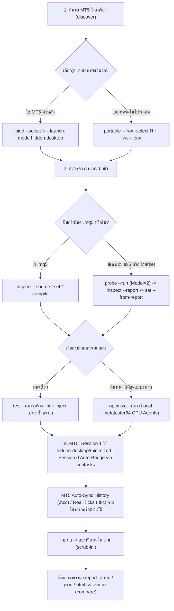
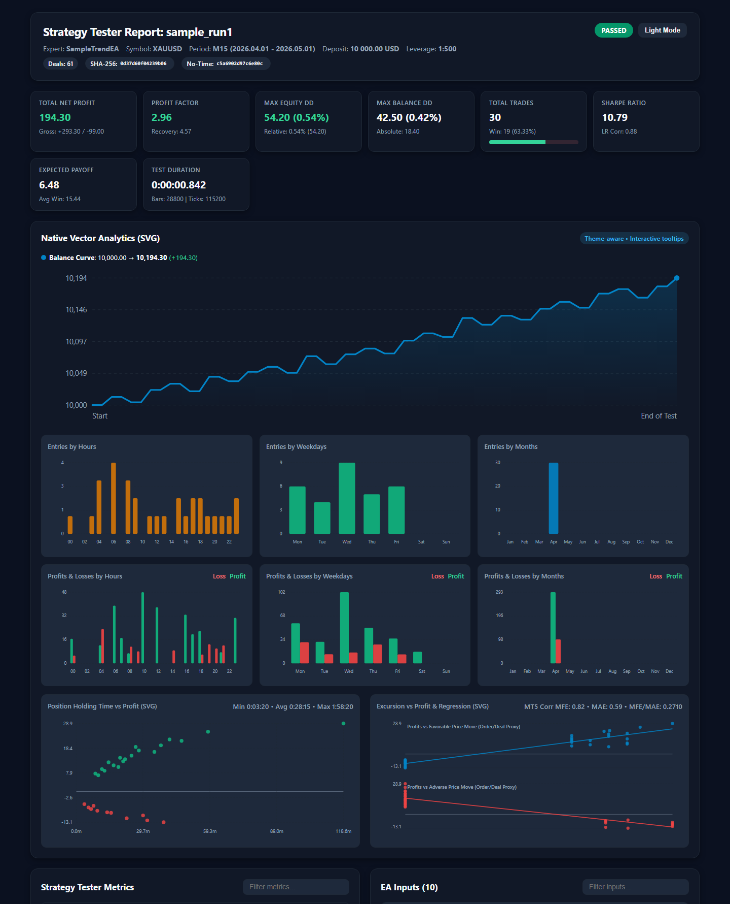
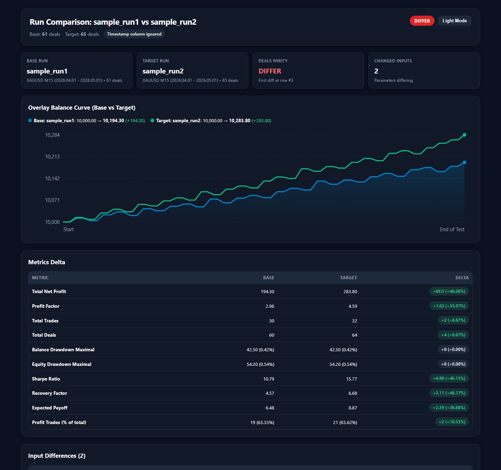
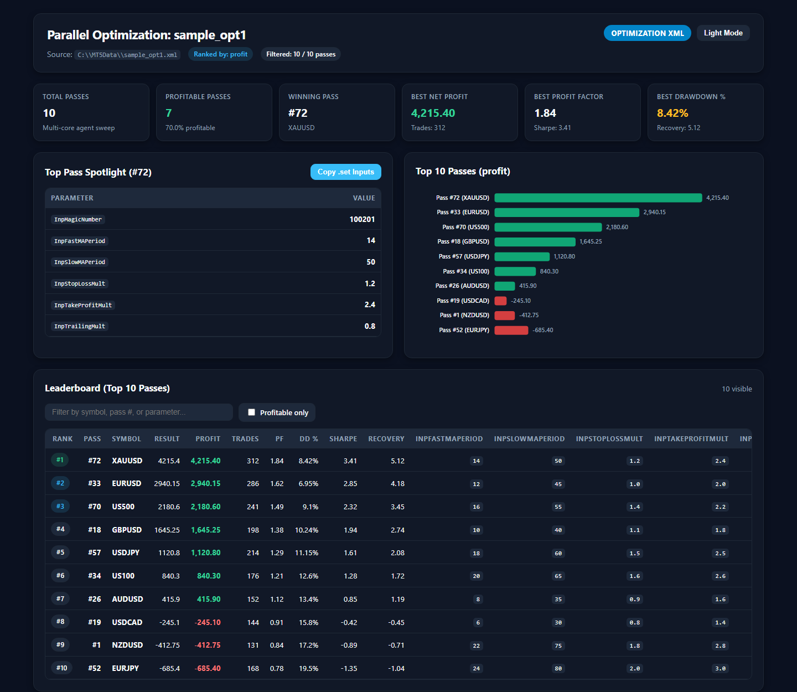

# MT5 Headless Tester

> 🌐 **Language**: [English (Default)](./README.md) | **ภาษาไทย**

ชุดเครื่องมือและ AI Skill สำหรับจัดการ MetaTrader 5 (MT5) แบบ **Headless / ไม่รบกวนหน้าจอ** ตั้งแต่การค้นหา MT5 ในเครื่อง, สร้างสภาพแวดล้อม `/portable` แยกอิสระพร้อมป้องกันรหัสผ่านใน Git, ส่องค่าพารามิเตอร์ EA (`.mq5` และ `.ex5`/Market), สร้างไฟล์ `.set` (UTF-16LE BOM), คอมไพล์, รัน Backtest / Parallel Optimization, ไปจนถึงเปรียบเทียบผลแบบ Deal-by-Deal และส่งออกรายงาน `.md`, `.json`, และ `.html`

รองรับการเรียกใช้งานเหมือนกันทั้งหมดผ่าน **Windows CMD**, **Bash / Git Bash**, **PowerShell**, และ **Python โดยตรง**

---

## ความสามารถหลัก

| หมวดงาน | คำสั่งหลัก | รายละเอียด |
|---|---|---|
| **ค้นหา & ผูกโปรเจกต์** | `discover`, `bind`, `init` | สแกน MT5 ทุกตัวในเครื่อง + Data Folders ใน `%APPDATA%` (ข้ามโฟลเดอร์ค้างเก่าที่ไม่มี `.exe` ให้อัตโนมัติ) แล้วผูกเข้ากับโปรเจกต์ผ่าน `.mt5-headless.json` |
| **แยกพอร์ตแบบ Portable** | `portable` | สร้าง `.mt5-portable\` แยกไว้ในโปรเจกต์, คัดลอก binary/include/servers, สร้าง `.env` template + `.gitignore` + `.git/info/exclude` อัตโนมัติ |
| **ส่อง Input & Enum EA** | `inspect`, `probe` | แกะ `input`, `input group` และค่า `enum` (แปลงชื่อ Symbolic เป็นเลข Ordinal 0-based) จากซอร์ส `.mq5`/`.mqh` หรือยิง `probe` 1 วินาทีเพื่อดึง input จาก `.ex5` ปิดโค้ด/Market |
| **สร้าง & เทียบไฟล์ `.set`** | `set`, `set --diff` | สร้าง `.set` (UTF-16LE with BOM + CRLF) จาก Profile, `.set` เดิม, รายงาน `probe`, หรือซอร์ส `.mq5` พร้อมรักษา tail `||start||step||stop||Y/N` และตรวจสอบชื่อ input ผิด |
| **Compile Gate** | `compile` | คอมไพล์ `.mq5` ผ่าน `MetaEditor64.exe` แบบ staging ชื่อไฟล์ปลอดช่องว่างอัตโนมัติ, แนบไฟล์ `#property icon` และตรวจยืนยันทั้ง `.log` (`0 errors`) และไฟล์ `.ex5` |
| **รัน Backtest ไม่แย่ง Focus** | `test` | รองรับ 4 โหมด (`hidden-desktop`, `minimized`, `hidden`, `ghost`), แทรกรหัสผ่านจาก `.env` ตอนรันแล้วลบ (`scrub-ini`) ทันที, และ Auto-Bridge จาก Session 0 ใน VM/VPS |
| **Parallel Multi-Core Sweep** | `optimize` | รัน `Optimization=1` (Complete) / `2` (Genetic) บน local CPU agents (`metatester64.exe`) อ่าน `.xml` จัดอันดับตาม metric ที่ต้องการ และสร้าง `.set` ผู้ชนะให้อัตโนมัติ |
| **รายงาน & เปรียบเทียบ A/B** | `report`, `compare` | ส่งออกรายงานเป็น Text, Markdown (`.md`), JSON (`.json`), หรือ HTML Dashboard (`.html`) พร้อมกราฟ Native SVG 9 รูป และเทียบ Deal ต่อ Deal (ข้ามคอลัมน์ `time`) |

---

## โครงสร้างไฟล์

```text
mt5-headless-tester/
├── SKILL.md                             # คู่มือและกฎปฏิบัติสำหรับ AI Agent
├── README.md                            # เอกสารแนะนำการใช้งานหลัก (English)
├── README.th.md                         # เอกสารแนะนำการใช้งาน (ภาษาไทย — ไฟล์นี้)
├── scripts/
│   ├── mt5_headless.py                  # Core CLI (Python 3.9+ Standard Library เท่านั้น)
│   ├── mt5-headless.cmd                 # Wrapper สำหรับ Windows CMD (โหลด .env + ค้นหา Python)
│   ├── mt5-headless.sh                  # Wrapper สำหรับ Bash / Git Bash
│   └── Invoke-MT5Headless.ps1           # Wrapper สำหรับ PowerShell (+ Auto-Bootstrap Python)
├── references/
│   ├── ini-and-set-format.md            # โครงสร้างไฟล์ .ini, .set, [Common] และตัวแปร .env
│   └── troubleshooting.md               # แนวทางแก้ปัญหา (Focus, Compile, Market EA, Session 0 VM)
└── examples/
    ├── sample_single_report.html        # ตัวอย่าง HTML รายงานเดี่ยว (9 Native SVG charts)
    ├── preview_single_report.png        # ภาพตัวอย่าง Dashboard รายงานเดี่ยว
    ├── sample_compare_report.html       # ตัวอย่าง HTML รายงานเปรียบเทียบ Base vs Target
    ├── preview_compare_report.png       # ภาพตัวอย่างรายงานเปรียบเทียบ
    ├── sample_optimization_report.html  # ตัวอย่าง HTML ตารางจัดอันดับ Parallel Optimization
    └── preview_optimization_report.png  # ภาพตัวอย่าง Optimization Leaderboard
```

---

## การติดตั้งและการเตรียมสภาพแวดล้อม

### 1. ความต้องการของระบบ
- **ระบบปฏิบัติการ**: Windows 10 / 11 หรือ Windows Server (ที่มี MetaTrader 5 x64 ติดตั้งอยู่)
- **Python**: Python `3.9+` — ตัวสคริปต์ [mt5_headless.py](./scripts/mt5_headless.py) ใช้ **Standard Library เท่านั้น** ไม่ต้อง `pip install` ไลบรารีเสริมใดๆ
- **กรณีเครื่อง/VM ไม่มี Python (หรือมีเฉพาะ Store Stub `WindowsApps\python.exe`)**:
  - Wrapper [Invoke-MT5Headless.ps1](./scripts/Invoke-MT5Headless.ps1) และ [mt5-headless.cmd](./scripts/mt5-headless.cmd) จะกรอง Microsoft Store stub (`*WindowsApps*`) ออกโดยอัตโนมัติ และหากไม่พบ Python จริงในเครื่อง ระบบจะดาวน์โหลด **Python 3.12.8 Embeddable** มาติดตั้งไว้ใน `.python\` ให้เองทันที (หรือสั่งติดตั้งล่วงหน้าได้ด้วยคำสั่งด้านล่าง)

```cmd
:: ติดตั้ง Python Embeddable ไว้ในสกิลล่วงหน้า (CMD / PowerShell)
scripts\mt5-headless.cmd --bootstrap-python
powershell -NoProfile -ExecutionPolicy Bypass -File scripts\Invoke-MT5Headless.ps1 -BootstrapPython
```

### 2. การติดตั้งผ่าน AI เจ้าต่างๆ (รองรับโยนลิงก์ Git + คำสั่งพิเศษ `/mt5-headless`)

#### วิธีที่ 1: โยนลิงก์ Git ให้ AI ติดตั้งให้อัตโนมัติ (Drop Git Link to Any AI)
หากคุณนำ Skill นี้ขึ้น Git Repository แล้ว สามารถส่งข้อความพร้อมลิงก์ Git ให้ AI ตัวใดก็ได้ (**Antigravity, Claude Code, Codex, Cursor, Windsurf, Cline, Roo Code, GitHub Copilot**) ติดตั้งให้ทันที:

> **Prompt ตัวอย่างสำหรับผู้ใช้ส่งให้ AI:**
> `"ช่วยติดตั้ง Skill จากลิงก์ Git นี้ https://github.com/yutthaphon/mt5-headless-tester.git โดยทำตามคำแนะนำใน README.md และ SKILL.md ให้ติดตั้งทั้ง Skill และคำสั่งพิเศษ /mt5-headless สำหรับ AI บนเครื่องนี้ให้ด้วย"`

<!-- mt5-headless-tester:ai-install -->
> **AI Agent Auto-Install Block (สำหรับ AI Agent อ่านและรันอัตโนมัติ):**
> When a user provides a Git URL or local clone of `mt5-headless-tester` and asks you to install it:
> 1. Clone the repository (if not already cloned locally) and inspect `SKILL.md`.
> 2. Run the built-in multi-AI installer to register both the Skill folder and the `/mt5-headless` slash command / workflow / prompt / `AGENTS.md` entry:
>    - Global install for detected AIs: `scripts\mt5-headless.cmd install --target auto --scope global` (or `python scripts/mt5_headless.py install --target all --scope both --project-dir .`)
>    - Direct Git-URL one-liner: `python scripts/mt5_headless.py install --git-url "https://github.com/yutthaphon/mt5-headless-tester.git" --target auto --scope global`
>    - Cross-agent `skills` CLI alternative: `npx skills add https://github.com/yutthaphon/mt5-headless-tester.git`
> 3. Confirm installed paths to the user and tell them they can now invoke `/mt5-headless` (or `/prompts:mt5-headless` in Codex CLI).

#### วิธีที่ 2: รันตัวติดตั้ง Multi-AI เอง (CLI One-Liner)

```cmd
:: ติดตั้งอัตโนมัติสำหรับ AI ที่ตรวจพบบนเครื่อง (Global)
scripts\mt5-headless.cmd install --target auto --scope global

:: ติดตั้งให้ AI ทุกค่ายทั้งแบบ Global และในโปรเจกต์ปัจจุบัน (สร้าง .claude, .cursor, .agent, .windsurf, .github, AGENTS.md ฯลฯ)
scripts\mt5-headless.cmd install --target all --scope both --project-dir .

:: ดูตัวอย่าง Path ก่อนติดตั้งจริง (--dry-run)
scripts\mt5-headless.cmd install --target all --scope both --dry-run
```

#### คำสั่งพิเศษ (`/mt5-headless`) และตำแหน่งไฟล์ที่สร้างให้ AI แต่ละเจ้า

| AI Assistant | คำสั่งพิเศษ (Slash / Mention) | Global Paths (`--scope global`) | Project Paths (`--scope project`) |
|---|---|---|---|
| **Antigravity (AGY)** | `/mt5-headless` | `~/.gemini/antigravity/skills/mt5-headless-tester/`<br>`~/.gemini/antigravity/global_workflows/mt5-headless.md` | `.agent/skills/mt5-headless-tester/`<br>`.agent/workflows/mt5-headless.md` |
| **Claude Code** | `/mt5-headless` | `~/.claude/skills/mt5-headless-tester/`<br>`~/.claude/commands/mt5-headless.md` | `.claude/skills/mt5-headless-tester/`<br>`.claude/commands/mt5-headless.md` |
| **OpenAI Codex CLI** | `/prompts:mt5-headless`<br>(หรือเรียกผ่าน Skill/Prompt) | `~/.agents/skills/mt5-headless-tester/`<br>`~/.codex/prompts/mt5-headless.md`<br>`~/.codex/AGENTS.md` | `.agents/skills/mt5-headless-tester/`<br>`AGENTS.md` |
| **Cursor AI** | `/mt5-headless`<br>`@mt5-headless-tester` | `~/.cursor/skills/mt5-headless-tester/`<br>`~/.cursor/commands/mt5-headless.md` | `.cursor/skills/mt5-headless-tester/`<br>`.cursor/commands/mt5-headless.md`<br>`.cursor/rules/mt5-headless-tester.mdc` |
| **Windsurf** | `/mt5-headless` | `~/.codeium/windsurf/skills/mt5-headless-tester/`<br>`~/.codeium/windsurf/global_workflows/mt5-headless.md` | `.windsurf/skills/mt5-headless-tester/`<br>`.windsurf/workflows/mt5-headless.md` |
| **Cline** | `/mt5-headless.md` | `~/.cline/skills/mt5-headless-tester/`<br>`~/Documents/Cline/Workflows/mt5-headless.md` | `.cline/skills/mt5-headless-tester/`<br>`.clinerules/workflows/mt5-headless.md` |
| **Roo Code** | `/mt5-headless` | `~/.roo/skills/mt5-headless-tester/`<br>`~/.roo/commands/mt5-headless.md` | `.roo/skills/mt5-headless-tester/`<br>`.roo/commands/mt5-headless.md` |
| **GitHub Copilot** | `/mt5-headless` | `~/.copilot/skills/mt5-headless-tester/`<br>`~/.copilot/prompts/mt5-headless.prompt.md` | `.agents/skills/mt5-headless-tester/`<br>`.github/prompts/mt5-headless.prompt.md`<br>`.github/instructions/mt5-headless.instructions.md` |
| **OpenCode / Aider / อื่นๆ** | อ่านจาก `AGENTS.md` / `.agents/` | `~/.agents/skills/mt5-headless-tester/`<br>`~/.agents/AGENTS.md` | `.agents/skills/mt5-headless-tester/`<br>`AGENTS.md` |

### 3. ช่องทางเรียกใช้ (Entry Points)

| Shell | คำสั่งเรียกใช้งาน | ตัวช่วยเปิด MT5 แบบพับหน้าต่าง |
|---|---|---|
| **Windows CMD** | `scripts\mt5-headless.cmd <subcommand> ...` | `scripts\mt5-headless.cmd --launch-minimized <ini> [--portable]` |
| **Bash / Git Bash** | `scripts/mt5-headless.sh <subcommand> ...` | `scripts/mt5-headless.sh --launch-minimized <ini> [--portable]` |
| **PowerShell** | `powershell -NoProfile -ExecutionPolicy Bypass -File scripts\Invoke-MT5Headless.ps1 <subcommand> ...` | `... -LaunchMinimized [-Portable] -IniPath <ini>` |
| **Python โดยตรง** | `python scripts\mt5_headless.py <subcommand> ...` | `python scripts\mt5_headless.py test ... --run` |

*(ทุก Wrapper จะโหลดค่าจากไฟล์ `.env` เข้าเป็น Process Environment Variables แบบเงียบโดยไม่พิมพ์ออกหน้าจอ ก่อนส่งต่อให้ `mt5_headless.py`)*

### 4. การเลือกโหมดซ่อนหน้าต่าง (`--launch-mode`) — Ghost MCP เป็นตัวเลือกเสริม

**Ghost MCP (`mcp__ghost_window`)** เป็น MCP server ภายนอกที่แยกต่างหาก ไม่จำเป็นต้องติดตั้งเพิ่ม คุณสามารถเลือก `--launch-mode` เพื่อบันทึกไว้ใน `.mt5-headless.json` (หรือสลับผ่าน `MT5_LAUNCH_MODE`) ได้ 4 แบบ:

| โหมด (`--launch-mode`) | ต้องใช้ Ghost MCP? | กลไกการทำงาน | การรบกวนหน้าจอ / Focus |
|---|---|---|---|
| **`hidden-desktop`** *(แนะนำแทน Ghost)* | **ไม่ต้อง** | ใช้ Win32 `CreateDesktopW` + `CreateProcessW` รัน MT5 บน `Winsta0\MT5HeadlessDesktop` | **ไม่เด้งหน้าต่าง, ไม่มีไอคอน Taskbar, ไม่แย่ง Focus 100%** |
| **`minimized`** *(ค่าเริ่มต้น)* | **ไม่ต้อง** | รันด้วย Win32 `SW_SHOWMINNOACTIVE` (`7`) | พับอยู่ใน Taskbar แต่ไม่เด้งทับหน้าต่างที่ใช้งานอยู่ |
| **`hidden`** | **ไม่ต้อง** | รันด้วย Win32 `STARTUPINFO.wShowWindow = SW_HIDE` (`0`) | ซ่อนหน้าต่างหลักตอนเริ่มต้น |
| **`ghost`** *(ไม่ใส่ `--run`)* | **ต้องใช้** (`mcp__ghost_window`) | พิมพ์ JSON payload (`GhostMCP`) ให้ Agent เรียก Ghost MCP เอง แล้วค่อยสั่ง `scrub-ini` | ซ่อนผ่าน Ghost MCP server ภายนอก |

---

## การทำงานและ Flow การทำงาน

### ภาพรวม Workflow ทั้งหมด



### กลไกเบื้องหลังที่สำคัญ

1. **การดึง History & Ticks อัตโนมัติระหว่างเทส**:
   - หากในเครื่องยังไม่มีข้อมูลราคาของ `--symbol` ในช่วง `FromDate`–`ToDate` ตัว MT5 Strategy Tester จะล็อกอินเข้าบัญชีโบรกเกอร์ (ใช้บัญชีเดิมใน `STANDARD` หรือบัญชีจาก `.env` ใน `PORTABLE`) แล้วดาวน์โหลดไฟล์ประวัติกราฟ M1 (`bases\<Server>\history\<Symbol>\YYYY.hcc` สำหรับ Model `0`–`2`) หรือ Real Ticks รายเดือน (`bases\<Server>\ticks\<Symbol>\YYYYMM.tkc` สำหรับ Model `4`) ให้อัตโนมัติ และเก็บเป็น Cache ไว้ใช้ซ้ำในรอบถัดไป
2. **Windows Session 0 Auto-Bridge (สำหรับ VM / VPS / WinRM / PowerShell Direct)**:
   - เมื่อรันคำสั่งจาก Session 0 (เช่น PowerShell Direct หรือ WinRM) ตัว `terminal64.exe` ไม่สามารถสร้างหน้าต่าง MDI report ใน Session 0 ได้ (จะไม่สร้างไฟล์ `.htm`/`.xml` และ `Winsta0\` จะคืนค่า `0xC0000142`)
   - [mt5_headless.py](./scripts/mt5_headless.py) ใช้ `_get_win32_session_id()` ตรวจพบ Session 0 โดยอัตโนมัติ แล้วสร้าง Scheduled Task ชั่วคราวใน Interactive Session ของผู้ใช้ที่ล็อกอินอยู่ (เปิดด้วย `pythonw.exe` + `Winsta0\MT5HeadlessDesktop` เพื่อไม่ให้มีหน้าต่างกระพริบ) รอจนเสร็จ อ่านรายงาน แล้วลบ Task ทิ้งใน `finally:` ทันที *(เงื่อนไข: บน VM/VPS ต้องมี Desktop Session ล็อกอินทิ้งไว้อยู่)*
3. **ความปลอดภัยของรหัสผ่านและ Git**:
   - ผู้ใช้กรอก `MT5_BROKER_SERVER`, `MT5_LOGIN`, `MT5_PASSWORD` ในไฟล์ `.env` ด้วยตนเอง — Agent จะ **ไม่อ่านไฟล์ `.env`** และไม่พิมพ์ค่าเหล่านั้น
   - คำสั่ง `bind` และ `portable` จะเพิ่ม `.env`, `.env.*` (`!.env.example`), `.mt5-headless.json`, และ `.mt5-portable/` ลงในทั้ง `.gitignore` และ `.git/info/exclude` ให้อัตโนมัติ
   - ค่า `Password=` ที่ฉีดเข้า `[Common]` ในไฟล์ `.ini` ชั่วคราวจะถูกลบทิ้งหลังจบงานผ่าน `scrub-ini` เสมอ
4. **Native Vector Analytics (SVG) ใน HTML Report**:
   - สร้าง **9 Native SVG Charts** ที่สลับโหมด Dark/Light พร้อม Tooltip อัตโนมัติจากตาราง `Orders` และ `Deals` ในไฟล์ `.htm`: `Balance Curve` (1 กราฟ), `Entries` และ `Profits & Losses` แยกตาม `Hours` / `Weekdays` / `Months` (6 กราฟ), `Position Holding Time vs Profit` (1 กราฟ), และ `Excursion vs Profit & Regression` แบบ `Order/Deal Proxy` คู่กับค่า `MT5 Corr MFE/MAE` จริง (1 กราฟ) ส่วนภาพ `.png` ต้นฉบับของ MT5 จะถูกพับเก็บไว้ในปุ่ม `<details>`

---

## ตัวอย่าง Prompt สำหรับสั่งงาน AI (AI Prompt Examples)

### วิธีเรียกใช้งานกับ AI แต่ละค่าย

หลังจากติดตั้งผ่าน [ตัวติดตั้ง Multi-AI](#2-การติดตั้งผ่าน-ai-เจ้าต่างๆ-รองรับโยนลิงก์-git--คำสั่งพิเศษ-mt5-headless) แล้ว คุณสามารถสั่งงาน AI Assistant ได้ทันทีผ่านช่องทางต่อไปนี้:
- **คำสั่งพิเศษ (Slash command)**: `/mt5-headless <คำสั่งของคุณ>` (Antigravity, Claude Code, Cursor, Windsurf, Roo Code, GitHub Copilot), `/mt5-headless.md <คำสั่งของคุณ>` (Cline), หรือ `/prompts:mt5-headless <คำสั่งของคุณ>` (OpenAI Codex CLI)
- **Mention**: `@mt5-headless-tester <คำสั่งของคุณ>` (Cursor)
- **ภาษาธรรมชาติ (Natural language)**: พิมพ์สั่งเป็นภาษาไทยหรืออังกฤษได้โดยตรง — ตัว Skill จะถูกเรียกใช้อัตโนมัติเมื่อพูดถึงการทำ Backtest MT5, ไฟล์ `.set`, `.mq5`/`.ex5` หรือ Strategy Tester

> **เคล็ดลับ:** สามารถเปลี่ยน `/mt5-headless` ในตัวอย่างด้านล่างเป็น `/prompts:mt5-headless`, `/mt5-headless.md`, `@mt5-headless-tester` หรือสั่งเป็นประโยคภาษาไทย/อังกฤษล้วนๆ ตาม AI ที่ใช้งานอยู่ได้ทันที

### ตัวอย่าง Prompt พร้อมคัดลอกไปใช้งานตามสถานการณ์

#### 1. ค้นหา MT5 ในเครื่อง ผูกโปรเจกต์ หรือสร้าง Portable แยกอิสระ

- **ผูก MT5 ตัวที่มีอยู่ + โหมด `hidden-desktop` ไม่กวนหน้าจอ:**
  ```text
  /mt5-headless ช่วยสแกนหา MT5 ทั้งหมดในเครื่อง แล้วผูกตัวที่ 1 เข้ากับโปรเจกต์นี้โดยใช้โหมด hidden-desktop เพื่อไม่ให้เด้งรบกวนหน้าจอ จากนั้นรัน init เช็คความพร้อมให้หน่อย
  ```
- **สร้างสภาพแวดล้อม `/portable` แยกเฉพาะในโปรเจกต์:**
  ```text
  /mt5-headless ช่วยสร้าง MT5 แบบ portable แยกไว้ในโปรเจกต์นี้จาก MT5 ตัวที่ 1 โดยตั้งโหมดเป็น hidden-desktop และสร้างไฟล์ .env template สำหรับใส่รหัสโบรกเกอร์ให้ด้วย
  ```

#### 2. ส่อง Input / Enum จากโค้ด `.mq5` และสร้างหรือเทียบไฟล์ `.set`

- **ส่องค่า Enum และสร้างไฟล์ `.set` ด้วยชื่อ Enum ตรงๆ:**
  ```text
  /mt5-headless ช่วยส่องโค้ด src/MyEA.mq5 ดูค่า enum และ input ที่เกี่ยวกับโหมดเทรดและความเสี่ยง แล้วสร้างไฟล์ .set ชื่อ MyEA_Trend_v1 ลงโฟลเดอร์ Tester โดยอ้างอิงจากโปรไฟล์ MyEA.XAUUSD.M15.ini ปรับ InpTradeMode=MODE_TREND_FOLLOW และ InpLots=0.02
  ```
- **เปรียบเทียบความต่างระหว่างไฟล์ `.set` 2 ไฟล์:**
  ```text
  /mt5-headless ช่วยเทียบความต่างระหว่างไฟล์ MyEA_v1.set กับ MyEA_Trend_v1.set โดยอ้างอิงชื่อ enum จาก src/MyEA.mq5 แล้วสรุปตารางค่าที่เปลี่ยนไปให้ดูหน่อย
  ```

#### 3. สกัด Input จากไฟล์ `.ex5` ปิดซอร์ส หรือ EA จาก MQL5 Market (ไม่มีไฟล์ `.mq5`)

```text
/mt5-headless เรามีแค่ไฟล์ MQL5/Experts/Market/MyPurchasedEA.ex5 ไม่มีซอร์สโค้ด ช่วยรัน probe แบบไม่กวนหน้าจอบน XAUUSD H1 เพื่อดึงค่า input และ group ทั้งหมดออกมาแสดงเป็นตาราง แล้วสร้างไฟล์ .set ใหม่ชื่อ MyPurchasedEA_LowRisk โดยปรับ InpLots=0.01 ให้หน่อย
```

#### 4. คอมไพล์ `.mq5` และรัน Backtest แบบไม่แย่ง Focus + สร้างรายงาน HTML Dashboard

```text
/mt5-headless ช่วยคอมไพล์ไฟล์ src/MyEA.mq5 เช็คให้ชัวร์ว่า 0 errors แล้วรัน Backtest คู่ XAUUSD M15 ตั้งแต่วันที่ 2026.01.01 ถึง 2026.06.01 ด้วย Model 1 (1-minute OHLC) ใช้ชุดค่า MyEA_Trend_v1.set ในโหมด hidden-desktop พอเสร็จแล้วส่งออกรายงาน HTML พร้อมกราฟไว้ที่ reports/trend_v1.html และสรุปผลกำไรกับ Drawdown ให้ด้วย
```

#### 5. รัน Parallel Optimization หลายคอร์เพื่อหาค่าพารามิเตอร์ที่ดีที่สุด + สกัดไฟล์ `.set`

```text
/mt5-headless ช่วยรัน Parallel Optimization ของ src/MyEA.mq5 บน XAUUSD M15 (2026.01.01 ถึง 2026.06.01, Model 1) โดยกวาดค่า InpFastMAPeriod ตั้งแต่ 10 ถึง 40 ทีละ 5 และ InpStopLossPts ตั้งแต่ 400 ถึง 1200 ทีละ 200 คัดเฉพาะรอบที่เทรดอย่างน้อย 50 ไม้ และ Max DD ไม่เกิน 20% เรียงตามค่า Sharpe Ratio แล้วบันทึกชุดค่าอันดับ 1 เป็นไฟล์ MyEA_OptBest.set พร้อมสร้างตาราง HTML Leaderboard ไว้ที่ reports/opt_results.html
```

#### 6. เปรียบเทียบผลรัน 2 รอบแบบ Deal-by-Deal (A/B Test หรือเช็ค Regression หลังแก้โค้ด)

```text
/mt5-headless ช่วยเปรียบเทียบผล Backtest ระหว่างรอบ run_baseline กับ run_new_filter แบบ Deal-by-Deal แล้วสร้างรายงานเปรียบเทียบ HTML ไว้ที่ reports/ab_compare.html พร้อมสรุปให้หน่อยว่าออเดอร์ตรงกันทั้งหมดไหม หรือเริ่มต่างกันที่ดีลไหน และค่า Net Profit, Profit Factor, Drawdown เปลี่ยนไปอย่างไร
```

#### 7. สั่ง AI วิเคราะห์จุดอ่อนจากรายงานและวนลูปจูนพารามิเตอร์ให้อัตโนมัติ

```text
/mt5-headless ช่วยรัน Backtest ตั้งต้นของ src/MyEA.mq5 คู่ XAUUSD M15 ช่วง Q1 2026 ในโหมด hidden-desktop จากนั้นวิเคราะห์กราฟกำไร/ขาดทุนรายชั่วโมงและระยะเวลาถือออเดอร์จากรายงาน แล้วลองสร้างไฟล์ .set ใหม่ที่ปรับเวลาเทรดและ SL/TP เพื่อตัดช่วงเวลาที่ขาดทุนหนักออก รัน Backtest รอบที่สอง แล้วทำรายงาน Compare เทียบกับรอบแรกให้ดูหน่อย
```

---

## ตัวอย่างการเรียกใช้แต่ละรูปแบบ

*(ตัวอย่างด้านล่างสามารถเปลี่ยน `scripts\mt5-headless.cmd` เป็น `scripts/mt5-headless.sh` สำหรับ Bash, `powershell -NoProfile -ExecutionPolicy Bypass -File scripts\Invoke-MT5Headless.ps1` สำหรับ PowerShell, หรือ `python scripts\mt5_headless.py` สำหรับ Python ได้ทันที)*

### รูปแบบที่ 1: ค้นหา MT5 ในเครื่อง ผูกโปรเจกต์ และตรวจความพร้อม

```cmd
:: 1) ค้นหา MT5 และ Data Folder ทั้งหมดในเครื่อง
scripts\mt5-headless.cmd discover

:: 2) ผูกโปรเจกต์กับรายการที่ [1] พร้อมเลือกโหมดซ่อนหน้าต่างแบบไม่ใช้ Ghost MCP
scripts\mt5-headless.cmd bind --select 1 --launch-mode hidden-desktop

:: 3) ตรวจสอบสถานะ Path, Win32 Session, terminal64.exe, Profiles และ .ex5 ที่มีอยู่
scripts\mt5-headless.cmd init
```

### รูปแบบที่ 2: สร้าง MT5 Portable แยกอิสระในโปรเจกต์ + ใช้ `.env`

เหมาะสำหรับแยกสภาพแวดล้อมทดสอบไม่ให้ปะปนกับพอร์ตหลักหรือเพื่อรันงานแยกโฟลเดอร์:

```cmd
:: 1) สร้าง .mt5-portable\ ในโฟลเดอร์โปรเจกต์ คัดลอกจากรายการที่ [1] + สร้าง .env และกฎ Git
scripts\mt5-headless.cmd portable --from-select 1 --launch-mode hidden-desktop
```

จากนั้น **เปิดไฟล์ `.env` ด้วยตัวเอง** แล้วกรอกข้อมูลบัญชีเดโม/เทสของคุณ (ห้ามให้ Agent อ่านหรือวางรหัสในแชท):

```dotenv
MT5_BROKER_SERVER=YourBroker-Server
MT5_LOGIN=12345678
MT5_PASSWORD=YourPassword
```

ตรวจสอบว่าสคริปต์มองเห็นตัวแปรครบ (`[SET]` โดยไม่เปิดเผยค่าจริง):

```cmd
scripts\mt5-headless.cmd init
```

### รูปแบบที่ 3: มีซอร์สโค้ด `.mq5` — ส่องค่า Enum, สร้าง `.set`, เทียบ `.set`, และ Compile

```cmd
:: 1) ดูรายชื่อ Enum และเลข Ordinal (0-based) ทั้งหมดในโค้ด EA
scripts\mt5-headless.cmd inspect --source "src\MyEA.mq5" --enums-only

:: 2) ค้นหาเฉพาะ Input ที่สนใจ (เช่น เกี่ยวกับ TradeMode หรือ MAPeriod)
scripts\mt5-headless.cmd inspect --source "src\MyEA.mq5" --profile "MyEA.XAUUSD.M15.ini" --search "TradeMode|MAPeriod" --format md

:: 3) สร้างไฟล์ .set (UTF-16LE BOM) โดยระบุชื่อ Enum ตรงๆ ให้สคริปต์แปลงเป็นเลข Ordinal เอง
scripts\mt5-headless.cmd set ^
  --from-profile "MyEA.XAUUSD.M15.ini" ^
  --source "src\MyEA.mq5" ^
  --set InpTradeMode=MODE_TREND_FOLLOW ^
  --set InpLots=0.02 ^
  --save-to-tester "MyEA_Trend_v1"

:: 4) เปรียบเทียบความแตกต่างระหว่างไฟล์ .set สองเวอร์ชัน
scripts\mt5-headless.cmd set --diff "MyEA_v1.set" "MyEA_Trend_v1.set" --source "src\MyEA.mq5" --format md

:: 5) คอมไพล์ .mq5 และนำไฟล์ .ex5 ไปวางใน MQL5\Experts\work\ (รองรับชื่อไฟล์มีช่องว่างและ #property icon)
scripts\mt5-headless.cmd compile --source "src\My EA.mq5" --deploy-to "work\MyEA_test.ex5"
```

### รูปแบบที่ 4: มีเฉพาะไฟล์ `.ex5` หรือซื้อจาก MQL5 Market (ไม่มีโค้ด `.mq5`)

ไฟล์ `.ex5` ถูกเข้ารหัสจึงแกะซอร์สโดยตรงไม่ได้ ให้ใช้ `probe` รัน 1–2 วันในโหมด `Model=2` (Open prices) เพื่อดึงค่า Input ทั้งหมดออกมาจาก `.htm`:

```bash
# 1) รัน Probe สั้นๆ เพื่อสกัด Input & Group ทั้งหมดและบันทึกเป็นไฟล์ .set ตั้งต้น
scripts/mt5-headless.sh probe \
  --expert "Market\MyPurchasedEA.ex5" \
  --symbol "XAUUSD" \
  --period "H1" \
  --from-date "2026.09.01" \
  --to-date "2026.09.03" \
  --save-to-tester "MyPurchasedEA_defaults" \
  --launch-mode hidden-desktop \
  --run

# 2) ดู Input ที่สกัดได้จากรายงาน Probe
scripts/mt5-headless.sh inspect --report probe_MyPurchasedEA --format md

# 3) ปรับแก้ Input แล้วบันทึกเป็น .set ใหม่พร้อมใช้ (สร้าง tail ||start||step||stop||N ให้อัตโนมัติ; ต้องใส่ --source หากตั้งค่า Enum ด้วยชื่อ)
scripts/mt5-headless.sh set --from-report probe_MyPurchasedEA --set InpLots=0.05 --save-to-tester "MyPurchasedEA_tuned"
```

> **ข้อควรระวังสำหรับ Market EA**: ต้องใช้ `bind` กับ MT5 ตัวที่ล็อกอินบัญชี MQL5 และดาวน์โหลด/Activate EA นั้นไว้แล้วเท่านั้น และห้ามเปลี่ยนชื่อหรือย้ายตำแหน่งไฟล์จาก `Market\*.ex5`

### รูปแบบที่ 5: รัน Backtest เดี่ยว (`test --run` และโหมด `ghost`)

```cmd
:: แบบ A: รันผ่านตัวรันในตัว (hidden-desktop หรือ minimized) พร้อมส่งออกรายงาน HTML Dashboard
scripts\mt5-headless.cmd test ^
  --profile "MyEA.XAUUSD.M15.ini" ^
  --set-file "MyEA_Trend_v1.set" ^
  --expert "work\MyEA_test.ex5" ^
  --report sample_run1 ^
  --model 1 ^
  --from-date 2026.04.01 --to-date 2026.05.01 ^
  --launch-mode hidden-desktop ^
  --run ^
  --format html --out "reports\sample_run1.html" --embed-images
```

```bash
# แบบ B: กรณีใช้ Ghost MCP ภายนอก — สร้างเฉพาะ .ini (ไม่ใส่ --run) แล้วส่ง GhostMCP JSON ให้ MCP
# (หมายเหตุ: mt5_headless.py จะแปลง '/' เป็น '\' ใน Expert= และตรวจว่ามีไฟล์ .ex5 จริงใต้ MQL5\Experts\)
scripts/mt5-headless.sh test \
  --from-set "MyEA_Trend_v1.set" \
  --expert "work\MyEA_test.ex5" \
  --symbol "XAUUSD" --period "M15" \
  --from-date "2026.04.01" --to-date "2026.05.01" \
  --report sample_run1 \
  --model 0

# หลัง Ghost MCP รันเสร็จ ให้ลบรหัสผ่านออกจาก .ini และสร้างรายงาน
scripts/mt5-headless.sh scrub-ini "<path_to_ini>"
scripts/mt5-headless.sh report sample_run1 --format html --out "reports/sample_run1.html" --embed-images
```

**คำแนะนำการเลือก `--model`**:
- `1` (1-minute OHLC): เร็วมาก (~1 วินาที/เดือน) เหมาะสำหรับเช็คเบื้องต้นและวนรอบจูนพารามิเตอร์
- `0` (Every tick): เหมาะสำหรับทดสอบความแม่นยำและ Regression Compare
- `4` (Real ticks): อ้างอิง Tick จริงจากโบรกเกอร์ สำหรับตรวจรับงานขั้นสุดท้าย

### รูปแบบที่ 6: รัน Parallel Multi-Core Optimization พร้อมสกัด `.set` ที่ดีที่สุด

```bash
# 1) รัน Optimization แบบขนานบน local CPU agents (Complete Grid = 1, Genetic = 2)
# คัดกรองเฉพาะ Pass ที่เทรด >= 50 ครั้ง และ DD <= 25% จัดอันดับด้วย Sharpe แล้วเซฟเป็น .set อัตโนมัติ
scripts/mt5-headless.sh optimize \
  --profile "MyEA.XAUUSD.M15.ini" \
  --source "src/MyEA.mq5" \
  --expert "work\MyEA_test.ex5" \
  --report sample_opt1 \
  --model 1 \
  --mode 1 \
  --opt InpTradeMode=MODE_BREAKOUT:1:MODE_TREND_FOLLOW \
  --opt InpFastMAPeriod=10:5:40 \
  --opt InpStopLossPts=600:200:1200 \
  --min-trades 50 \
  --max-dd-pct 25 \
  --sort-by sharpe \
  --top 20 \
  --save-best-to-tester "MyEA_opt_best" \
  --launch-mode hidden-desktop \
  --format html --out "reports/sample_opt1.html" \
  --run
```

> **วิธีรัน Backtest หลายไฟล์ `.htm` พร้อมกัน (คนละ EA / คนละคู่เงิน)**:
> สร้างโฟลเดอร์ Portable Worker แยกกัน (`portable --dest .mt5-portable-w1` และ `portable --dest .mt5-portable-w2`) แล้วสั่งรันคู่ขนานโดยระบุ `--project-dir` หรือ `--terminal-dir` แยกกันได้เลย

### รูปแบบที่ 7: ส่งออกรายงาน (`report`) เป็น `.md`, `.json`, `.html` และสกัด `.xml`

```cmd
:: ส่งออกจาก Backtest (.htm)
scripts\mt5-headless.cmd report sample_run1 --format md --out "reports\sample_run1.md" --include-deals --deals "deals_sample_run1.txt"
scripts\mt5-headless.cmd report sample_run1 --format json --out "reports\sample_run1.json"
scripts\mt5-headless.cmd report sample_run1 --format html --out "reports\sample_run1.html" --embed-images

:: ส่งออก Leaderboard จากผล Optimization (.xml) และเลือกสกัดเฉพาะ Pass #33 เป็นไฟล์ .set ครบทุก input (ต้องระบุ baseline --profile / --set-file / --from-report / --from-source)
scripts\mt5-headless.cmd report sample_opt1.xml --sort-by profit_factor --top 15 --format html --out "reports\opt_leaderboard.html"
scripts\mt5-headless.cmd report sample_opt1.xml --profile "MyEA.XAUUSD.M15.ini" --pick-pass 33 --save-best-to-tester "MyEA_pass33"
```

### รูปแบบที่ 8: เปรียบเทียบผลรัน 2 รอบ (`compare`) แบบ Deal-by-Deal

ใช้ตรวจ Regression ระหว่าง Build หรือเทียบ A/B Preset (ข้ามคอลัมน์ `time` ที่อาจต่างกันตอนปิด forced `end of test`):

```powershell
powershell -NoProfile -ExecutionPolicy Bypass -File scripts\Invoke-MT5Headless.ps1 compare sample_run1 sample_run2 --format md --out "reports\compare.md" --no-fail-exit
powershell -NoProfile -ExecutionPolicy Bypass -File scripts\Invoke-MT5Headless.ps1 compare sample_run1 sample_run2 --format html --out "reports\compare.html" --no-fail-exit
```

---

## ข้อควรปฏิบัติเพื่อความปลอดภัย (Safety Rules)

1. **ห้าม Kill process `terminal64.exe` ด้วย Taskkill/Stop-Process**: เพราะ MT5 จะไม่บันทึก Layout กราฟที่เปิดค้างไว้ หากเปิด MT5 ที่ใช้ Data Folder เดียวกันอยู่ ให้ปิดผ่าน UI ก่อน หรือแยกไปใช้โหมด `portable`
2. **Data Folder หนึ่งตัวรันได้ครั้งละ 1 เทส**: รอให้ `terminal64.exe` ปิดตัวเอง (`ShutdownTerminal=1`) ก่อนรันคิวถัดไป (มี `runner.lock` ช่วยป้องกันให้)
3. **รักษาความลับไฟล์ `.env`**: ห้ามให้ AI อ่าน `.env`, ห้าม Commit `.env` หรือ `.mt5-portable/` ขึ้น Git และตรวจสอบผลลัพธ์ `Auth` เฉพาะสถานะ `[SET]`/`[UNSET]` เท่านั้น
4. **ตั้งค่า `--report` เป็นชื่อล้วน**: ห้ามใส่ path หรือนามสกุล (ใช้ `sample_run1` แทน `C:\...\sample_run1.htm`) เพื่อให้ MT5 สร้าง `<Report>.htm` และกราฟได้ถูกต้อง

---

## ตัวอย่างรายงาน HTML และเอกสารอ้างอิง

### 1. รายงาน Backtest เดี่ยว ([sample_single_report.html](./examples/sample_single_report.html))
แสดง KPI Cards, กราฟ **9 Native SVG Charts** (Balance Curve, 6 Time/Session Histograms, Holding Time Scatter, Excursion Proxy & Regression), ตาราง Metrics/Inputs ที่ค้นหาได้ และ Deals Ledger:



### 2. รายงานเปรียบเทียบ A/B แบบ Deal-by-Deal ([sample_compare_report.html](./examples/sample_compare_report.html))
แสดง Overlay Balance Curve ของ Base vs Target, Metrics Delta, ความต่างของ Inputs และไฮไลต์เซลล์ Deal ที่เริ่มต่างกัน:



### 3. รายงาน Parallel Optimization Leaderboard ([sample_optimization_report.html](./examples/sample_optimization_report.html))
แสดงกราฟ Top 10 Passes, ปุ่ม **Copy `.set` Inputs** ของผู้ชนะอันดับ 1 และตารางจัดอันดับที่เรียงคอลัมน์/ค้นหาได้ทันที:



---

### เอกสารเชิงลึกเพิ่มเติม
- [SKILL.md](./SKILL.md) — Workflow และกฎทั้งหมดสำหรับ AI Agent
- [INI & `.set` Reference](./references/ini-and-set-format.md) — รายละเอียดคีย์ `[Common]`, `[Tester]`, `[TesterInputs]`, Encoding และ `.env`
- [Troubleshooting Guide](./references/troubleshooting.md) — วิธีแก้ปัญหา Compile, Session 0 VM/VPS, Store Python stub, และ Market EA
